# Audit UX dan alur · RedTree IoT (branch `upgrade-visual`)

Disusun oleh ui-ux-designer, 23 Nov 2026. Dasar: `DESIGN.md`, `CLAUDE.md`, `docs/referensi-upgrade.md`, `site/index.html`, `site/styles.css`, `site/script.js`, `site/wa-float.js`, dan tampilan nyata di browser (server lokal 127.0.0.1:8791, lebar 375, 768 tidak diuji terpisah karena layout tablet = layout HP di bawah 1024 dengan satu kolom, dan 1440).
Tidak ada kode yang diubah. Semua ukuran di bawah diukur dari DOM (getBoundingClientRect) atau dihitung dengan rumus WCAG (kontras = (L1+0,05)/(L2+0,05)).

Sumber luar yang benar-benar dibaca: W3C, Understanding SC 2.4.11 Focus Not Obscured (Minimum), https://www.w3.org/WAI/WCAG22/Understanding/focus-not-obscured-minimum.html (sticky header/footer yang menutupi elemen berfokus dapat gagal). Kriteria WCAG lain (1.4.3, 1.4.11, 2.2.2, 2.4.7, 4.1.3) dirujuk dari pengetahuan umum, tidak diambil ulang.

---

## (a) Peta alur pengunjung

Panjang halaman terukur: desktop 1440 = 10.656 px (11,8 layar); HP 375x812 = 15.594 px (19,2 layar).

```mermaid
flowchart TD
  A([Masuk: Google / Instagram / TikTok]) --> H
  subgraph HERO["#top Hero (HP: y 65-1331)"]
    H["H1 + lead + CTA WhatsApp\nHP y=361 (0,4 layar); desktop y=614"]
    M["Peta kebun simulasi\n(HP 687 px tinggi)"]
  end
  H -->|CTA 1 bergulir 0| WA0["wa.me polos, tanpa teks awal"]
  H --> S["#sektor 5 baris\n(tanpa penanda tautan)"]
  M --> S
  S -->|Perkebunan| P1["/monitoring-kebun-sawit/ (ID saja)"]
  S -->|Pabrik sawit, Pabrik, Gedung| P2["/jasa-iot-otomasi-medan/ (3 baris, 1 tujuan)"]
  S -->|Sekolah| P3["/pelatihan-plc-iot-medan/ (6 dari 7 kursus Segera hadir)"]
  S --> L["#layanan 2x2 + 4 tautan kartu"]
  L --> AL["#alur diagram sticky + 4 langkah"]
  AL --> PR["#proyek bento 9 proyek\n(HP 4.518 px = 29% halaman)"]
  PR --> TR["#pelatihan\nCTA 2 (HP y=10.358)"]
  TR --> AB["#tentang"]
  AB --> PS["#proses Cara kami bekerja\nCTA 3 (HP y=12.360)"]
  PS --> FQ["#faq\nCTA 4 (HP y=13.060)"]
  FQ --> K["#kontak band merah + form\nCTA akhir HP y=14.363 (17,7 layar)"]
  K -->|Buka WhatsApp| WA1["wa.me dengan teks awal (satu-satunya yang terisi, selain tombol pelatihan)"]
  FLOAT(["Tombol WA melayang\nmuncul setelah hero, hilang di #kontak"]) -.->|tap| WA0
  P1 & P2 & P3 --> BUNTU{{"Halaman ID saja,\ntanpa tombol bahasa"}}
  BUNTU --> WA2["WA terisi konteks (bagus)"]
```

Ringkasan jalur: CTA pertama = 0 gulir (HP 0,44 layar; desktop ada di header dan hero). CTA terakhir = form di dasar halaman (HP 17,7 layar; desktop 10,9 layar). Di antaranya hanya ada 4 tombol WA di bagian pelatihan, proses, FAQ, dan tombol melayang. Jalur tercepat HP: tap WA di hero (1 langkah). Jalur "paham dulu" memakai 11 bagian sebelum form.

---

## (b) Temuan, dari dampak terbesar

Skala dampak: T = tinggi (menghalangi konversi atau gagal aksesibilitas), S = sedang, R = rendah.

### 1. [T] Fokus keyboard tidak terlihat di band kontak
- Bagian/lebar: `#kontak` (band merah), semua lebar.
- Bukti: `:focus-visible { outline: 3px solid var(--red) }` berlaku untuk tautan telepon, tombol "Salin nomor", Instagram, TikTok di dalam `.cta` (latar `#E0301E`). Terukur di browser setelah Tab: `outlineColor rgb(224,48,30) solid 2.4px` pada tautan telepon. Kontras cincin terhadap latar = 1,00:1 (WCAG 2.4.7 dan 1.4.11 butuh 3:1). Hanya `.submit` dan `.field` yang sudah punya cincin putih.
- Akibat: pengguna keyboard/pembaca layar kehilangan posisi tepat di bagian konversi.
- Perbaikan: `.cta :focus-visible { outline-color: #fff; outline-offset: 3px; }`. Putih di atas merah = 4,55:1 (lulus 3:1). Jangan memakai merah gelap (1,31:1).

### 2. [T] Baris sektor tidak terlihat sebagai tautan, tujuannya berulang, dan EN berujung buntu
- Bagian/lebar: `#sektor`, semua lebar; paling parah HP.
- Bukti: 5 baris `<a class="sector-link">` hanya berubah (warna merah, geser 6px) lewat `@media (hover: hover)`. Di HP tidak ada petunjuk apa pun (screenshot 375: teks judul tebal tanpa ikon). Tujuan: Pabrik sawit, Pabrik, Gedung semuanya ke `/jasa-iot-otomasi-medan/` (3 baris, 1 halaman, tanpa jangkar sektor); Sekolah ke halaman pelatihan yang 6 dari 7 kursusnya "Segera hadir". Halaman tujuan tidak punya tombol bahasa (`pages.js`: "Indonesian-only"), sehingga pengunjung EN mendarat di halaman Indonesia tanpa peringatan. Pada beranda sendiri teks tautan "Pelajari lebih lanjut" sudah memberi tahu "(in Indonesian)", tetapi baris sektor tidak.
- Akibat: pengunjung HP tidak tahu baris bisa diketuk (jalan buntu yang tak terlihat); yang mengetuk mendapat halaman yang sama untuk tiga sektor lalu merasa salah klik; pengunjung EN kehilangan konteks.
- Perbaikan:
  1. Tambahkan panah (ikon SVG yang sama dengan `.card-link svg`, 24px, `stroke: var(--red-dark)`) di ujung kanan tiap baris, selalu tampil (bukan hanya hover), tanpa transition baru. Di HP baris `grid-template-columns: 1fr 24px`.
  2. Beri tiap baris tujuan yang membedakan: hanya baris yang punya halaman sendiri yang berupa tautan (Perkebunan). Untuk baris lain gunakan tautan WhatsApp berteks awal sektor (lihat temuan 5), atau jangkar baru di halaman jasa (TODO-PEMILIK, butuh konten).
  3. Di mode EN tambahkan keterangan kecil di bawah judul bagian: "Halaman tujuan berbahasa Indonesia." / "Linked pages are in Indonesian." (kunci i18n baru).

### 3. [T] Tombol WhatsApp melayang di HP menutupi konten, mengulang CTA yang sedang tampak, dan ikonnya bukan logo WA
- Bagian/lebar: global, 375px (juga desktop).
- Bukti: `.wa-float` 56x56 px, `right:16 bottom:16`, `z-index:40`. Screenshot 375 menunjukkan tombol menimpa teks langkah "Gateway mengirim" (`#alur`) dan foto/kartu proyek. `+` ikon FAQ berada di kanan 18px dan dapat tertutup. Skrip hanya menyembunyikan tombol di hero, `#kontak`, dan footer; ia tetap tampil saat tombol merah lain (pelatihan, proses, FAQ) sudah ada di layar. Di desktop pil "Chat WhatsApp" (205x56) selalu tampil bersama tombol header, jadi dua CTA merah permanen. Ikonnya `#i-wa` = gelembung obrolan garis, bukan logo WhatsApp. WCAG 2.4.11: elemen berfokus tidak boleh tertutup penuh oleh konten buatan penulis; tombol melayang bisa menutup elemen berfokus saat Tab di dekat tepi bawah.
- Akibat: konten tertutup, CTA ganda, beban visual, risiko fokus tertutup.
- Perbaikan:
  1. Di `wa-float.js` sembunyikan tombol juga saat elemen `[data-wa-cta]` (tombol merah di `#pelatihan`, `#proses`, `#faq`, dan form `#kontak`) terlihat di viewport (IntersectionObserver `threshold: 0.6`).
  2. HP (<700): ukuran 52x52 (masih >44), `bottom: max(16px, env(safe-area-inset-bottom))`, dan `body { padding-bottom: 0 }` tetap; tambahkan `scroll-padding-bottom: 88px` pada `html` agar elemen berfokus tidak berhenti di bawah tombol.
  3. Desktop (>=1024): sembunyikan pil (`display:none`) karena header sudah memuat CTA yang sama; tombol melayang hanya untuk <1024.
  4. Ganti ikon dengan logo WhatsApp resmi hanya bila pemilik menyetujui penggunaan merek (BUTUH PERSETUJUAN PEMILIK); sementara tambahkan teks "WA" tidak perlu. Alternatif aman: pertahankan ikon, label aria sudah ada.

### 4. [T] Hanya satu CTA yang berkonteks; empat tombol WhatsApp lain membuka obrolan kosong
- Bagian/lebar: header, hero, FAQ, proses, melayang (semua lebar).
- Bukti: `href="https://wa.me/6282272226678"` tanpa `?text=`. Hanya `#train-wa` (diisi lewat `script.js`), form `#kontak`, dan halaman landing (teks awal berbeda per halaman) yang berisi teks. Halaman landing sudah melakukannya, beranda tidak konsisten.
- Akibat: pengunjung membuka layar obrolan kosong dan harus mengarang kalimat sendiri; titik ragu terbesar sebelum mengirim pesan pertama. Pemilik juga tidak tahu dari bagian mana pesan datang.
- Perbaikan: tambah atribut `data-wa="hero|nav|faq|proses|float"` dan isi `href` lewat `script.js` dengan teks awal per konteks (ID/EN, kunci baru):
  - hero/nav/melayang: "Halo RedTree IoT, saya ingin bertanya tentang layanan Anda." / "Hello RedTree IoT, I'd like to ask about your services."
  - FAQ: "Halo RedTree IoT, saya punya pertanyaan yang belum terjawab di situs." / "Hello RedTree IoT, I have a question that the site did not answer."
  - proses langkah 1: "Halo RedTree IoT, kebutuhan saya: " (kursor di akhir, pengunjung melengkapi).
  Tidak boleh memuat harga atau janji waktu balas. Teks akhir TODO-PEMILIK.

### 5. [S] Bagian "Cara kami bekerja" (`#proses`) terlalu jauh dan tidak ada di menu
- Bagian/lebar: urutan halaman, semua lebar.
- Bukti: `#proses` berada di y=8.119 (desktop, 76% halaman) dan y=12.113 (HP, 78%), setelah `#tentang`. Pertanyaan pengunjung "kalau saya chat, lalu apa?" baru dijawab di sini. Menu (`Layanan, Proyek, Pelatihan, Tentang, FAQ, Kontak`) tidak memuat `#sektor`, `#alur`, `#proses`; DESIGN.md: "Bagian yang dipakai pengunjung punya judul sendiri dan masuk menu".
- Akibat: ragu di titik "apa yang terjadi setelah saya chat"; tiga bagian tidak bisa dicapai dari menu.
- Perbaikan: urutan baru `#top, #sektor, #layanan, #alur, #proyek, #proses, #pelatihan, #tentang, #faq, #kontak` (proses berpindah ke setelah proyek, sebelum pelatihan). Tambah item menu "Cara kerja" (EN "How it works") ke `#proses`; jangan menambah item lain (hindari menu penuh: pada 1440 menu sudah 6 item + bahasa + CTA). Cek aturan "dua bagian bersebelahan beda susunan" setelah pindah: proyek (bento) lalu proses (daftar vertikal, max 760px) lalu pelatihan (2 kolom sticky) = lolos.

### 6. [S] `#proyek` di HP: 4.518 px (29% halaman) dan foto layar kecil tidak terbaca
- Bagian/lebar: `#proyek`, 375px.
- Bukti: 9 kartu satu kolom + foto unggulan + 6 kredensial. Screenshot HP: foto SCADA 16:10 mengecil (teks layar tidak terbaca), foto "Pemantauan arus motor" berupa tangkapan HP kecil.
- Akibat: pengunjung HP melewati hampir 6 layar tanpa satu CTA; bagian ini lebih panjang dari hero + sektor + layanan digabung.
- Perbaikan:
  1. HP: tampilkan unggulan + 3 kartu pertama; sisa 5 kartu di dalam `
` ber-summary "Lihat 5 proyek lain" / "See 5 more projects" (target 52px, aturan DESIGN: tombol sekunder bertinta). Desktop tetap semua.
  2. Tambahkan satu tombol `btn-tint` "Tanya tentang pengalaman ini" di bawah daftar yang membuka WA berteks awal (lihat temuan 4); bukan klaim klien.
  3. Potongan foto khusus HP (art direction) sudah ditandai TODO-PEMILIK T6 di HTML, tetap menunggu aset dan izin.

### 7. [S] Diagram `#alur`: tahap tidak aktif terlalu pudar dan di HP isi diagram sama dengan daftar di bawahnya
- Bagian/lebar: `#alur`, >=1024 (pudar) dan <1024 (duplikat).
- Bukti: `.flow-fig[data-active] [data-node] { opacity: .35 }`. Teks label ink pada kotak putih yang memudar di latar `#F6F7F9`: kontras 2,15:1 (target 4,5:1). Pada opacity .65 = 5,07:1; .6 = 4,32:1. Di HP diagram (4 kotak: Sensor, Gateway, Dashboard, Tim Anda) diikuti daftar langkah yang mengulang empat judul yang sama; bagian 1.478 px.
- Akibat: tahap tidak aktif sulit dibaca (gagal AA bila dianggap teks informatif); di HP informasi ganda memperpanjang gulir.
- Perbaikan: ganti `.35` jadi `.65` dan bedakan aktif dengan `stroke: var(--red); stroke-width: 2.5` pada `.n-box` aktif (keadaan, bukan gerak). Di <1024 `.flow-fig { display: none }` dan beri `.flow-steps li::before` nomor merah yang sudah ada; diagram hanya muncul >=1024. `aria-describedby="flow-desc"` tetap.

### 8. [S] Ritme visual: dua bagian berpola "langkah bernomor merah" dan tiga kolom setara di `#tentang`
- Bagian/lebar: `#alur`, `#proses`, `#tentang`; desktop.
- Bukti: `#alur` dan `#proses` memakai pil `.num` merah dan garis atas merah pada item pertama (pola yang sama, 4 langkah). `#tentang` punya satu kalimat besar (dominan, benar) lalu `.values` 3 kolom setara (batas tipis). Urutan susunan terukur: sektor (daftar tipografis) / layanan (panel 2x2) / alur (2 kolom sticky) / proyek (bento) / pelatihan (2 kolom sticky) / tentang (kalimat + 3 kolom) / proses (kolom tunggal 760px) / FAQ (2 kolom) / kontak (2 kolom, band). Tidak ada dua bagian bersebelahan yang kembar (lolos aturan), tetapi `#pelatihan` dan `#faq` memakai pola intro-kiri + daftar-kanan yang sama dan `#faq`-`#kontak` sama-sama 2 kolom.
- Akibat: pengunjung merasa "sudah lihat ini" (diagnosis sama dengan `referensi-upgrade.md` bagian 0); ritme monoton di dasar halaman.
- Perbaikan:
  1. `#proses`: ganti nomor merah penuh menjadi angka besar tipografis `font-size: clamp(2.5rem, 2rem + 2vw, 3.5rem); font-weight: 800; color: var(--red-dark)` tanpa pil, tata 4 langkah horizontal pada >=1024 (4 kolom, langkah 1 lebih dominan: lebar 1,4fr, dan tombol WA ada di sana). Ini membedakan dari `#alur`.
  2. `#tentang`: jadikan satu kolom dominan (`about-lead` + paragraf) dan dua nilai pertama sebagai daftar tipografis dengan satu nilai lebih besar; atau gabungkan tiga nilai menjadi satu paragraf. Pilih yang paling sedikit membuat kolom setara (DESIGN: "tiga atau lebih kotak sama tanpa hierarki dilarang").
  3. `#faq`: ubah pola menjadi kolom tunggal `max-width: 760px` dengan judul di atas (bukan intro-kiri) agar tidak mengulang `#pelatihan`.

### 9. [S] ARIA live pada peta kebun yang berputar otomatis
- Bagian/lebar: hero, semua lebar.
- Bukti: `
` di dalam simulasi yang berganti cerita otomatis; isi notifikasi berubah tiap beberapa detik. Tombol "Jeda" ada (WCAG 2.2.2 terpenuhi), `prefers-reduced-motion` ditangani di `estate.js` (`reduce.matches`).
- Akibat: pembaca layar mengumumkan teks simulasi berulang-ulang dan menyela pembacaan; melanggar semangat 4.1.3 (pesan status harus berguna).
- Perbaikan: hapus `aria-live` dari `.phone`; ganti dengan `aria-live="off"`. Biarkan `<desc id="estate-desc">` menjelaskan simulasi. Label "Simulasi untuk ilustrasi" (`.estate-note`, 13px, `--muted`) dipindah ke dalam `.estate-bar` sebagai teks 14px agar terbaca sebelum peta, bukan di bawah.

### 10. [S] Bagian pelatihan: lencana "Segera hadir" diulang 6 kali
- Bagian/lebar: `#pelatihan`, semua lebar.
- Bukti: 6 baris dengan lencana identik ("Segera hadir", 13px; di HP 12px) dan 1 "Sesuai permintaan". Teks pengantar di atas sudah berkata "Jadwal kursus segera diumumkan".
- Akibat: terasa seperti daftar produk yang tidak tersedia (jalan buntu); kebisingan visual; teks 12px di bawah ambang nyaman.
- Perbaikan: hapus 6 lencana "Segera hadir", ganti satu baris status di atas daftar: pil `.badge` "Jadwal segera diumumkan" (EN "Schedule to be announced"), ukuran 14px. Baris "Pelatihan in-house" tetap bertanda "Sesuai permintaan" dan tampil dominan (latar `--tint`, judul merah gelap) karena itu satu-satunya yang bisa dipesan sekarang. Tombol WA tetap (sudah berteks awal).

### 11. [S] Microcopy ID/EN: kata kerja CTA tidak konsisten dan beberapa kalimat kaku
- Bukti (dari `index.html` dan `i18n-en.js`):

| Tempat | ID | EN sekarang | Masalah |
|---|---|---|---|
| Header/hero/FAQ/proses | Chat WhatsApp | WhatsApp us | "WhatsApp us" kaku; berbeda dari ID |
| Form kontak | Buka WhatsApp | Open WhatsApp | Tidak menyebut pesan sudah terisi |
| Pelatihan | Daftarkan minat via WhatsApp | Register interest on WhatsApp | Baik |
| FAQ intro | Chat kami langsung. | Message us directly. | Kata kerja berbeda dari tombol |
| Tombol hero kedua | Lihat layanan | See our services | Baik |
| Tautan landing | Pelajari lebih lanjut: | Learn more (in Indonesian): | Baik, perlu juga di baris sektor |

- Perbaikan teks:
  - `nav.wa`: ID "Chat WhatsApp", EN "Chat on WhatsApp".
  - `ct.send`: ID "Kirim lewat WhatsApp", EN "Send via WhatsApp".
  - `faq.p`: ID "Belum ketemu jawabannya? Chat kami." EN "Can't find your answer? Chat with us."
  - Label sr-only form `ct.need` perlu juga label terlihat kecil di atas `select` dan `input` (saat ini placeholder hilang saat mengetik; WCAG 3.3.2). Teks 14px putih di band merah = 4,55:1 (lulus).

### 12. [R] Kontras dan ukuran teks di peta, lencana, dan teks kecil
- Bukti (dihitung): nama blok peta `fill var(--ink)` dengan `opacity .55` di atas `#E3EBDD` = 3,44:1 (opacity .75 = 6,20:1). Teks 12-13px: `.estate-note`, `.story-steps li`, `.badge` (HP 12px), `.callout text` 12px. Kontras lain lulus: putih di merah `#E0301E` 4,55:1 (lulus tipis untuk tombol 16px/700), merah gelap di putih 5,95:1, di tint 5,48:1, `--muted` di putih/abu/tint 5,78 / 5,40 / 5,33, `--body` di putih 8,02, putih 70% di ink 6,54, putih 75% di ink 8,47. Teks merah `#E0301E` di atas abu = 4,25:1 (gagal AA; tidak dipakai untuk teks sekarang, tetap jangan dipakai).
- Perbaikan: `.block-names text { opacity: .75 }`; `.badge`/`.story-steps li`/`.estate-note` minimal 0.875rem (14px); aturan baru di DESIGN.md: teks merah `#E0301E` hanya boleh di latar putih untuk ukuran >=24px atau tebal >=18,66px.

### 13. [R] Header HP tidak punya tombol WhatsApp
- Bagian/lebar: header <1024px.
- Bukti: `.nav-wa { display:none }` di <1024px; WA hanya ada di panel menu (`.links-wa`, y=428 di dalam menu) dan di hero (y=361).
- Akibat: setelah gulir melewati hero, jalur ke WA hanya tombol melayang; menu butuh dua ketukan.
- Perbaikan: tidak perlu mengubah bila temuan 3 diterapkan (float tetap menjadi satu-satunya CTA persisten di HP). Jangan tambah tombol header di HP; ruang header 375px sudah penuh (logo, EN/ID, menu).

### Yang sudah baik (pertahankan)
- Target sentuh: di 375px tidak ada tautan/tombol di bawah 44px (diukur dengan DOM). Tombol hero 335x52.
- Tidak ada gulir horizontal: `scrollWidth` 375 pada 375px dan 1425 pada 1440px (selisih = bilah gulir).
- `prefers-reduced-motion`: aturan global mematikan animasi dan transisi; peta berhenti (`reduce.matches`).
- Teks awal pelatihan, landing page, dan form sudah dwibahasa; kebenaran konten terjaga: tidak ada angka, klien, testimoni, harga yang dikarang.
- Keterangan simulasi peta dan "bukan proyek klien" pada `#proyek` konsisten dengan CLAUDE.md.

---

## (c) Spesifikasi untuk web-developer

Kerjakan berurutan. Setiap nomor: catat selisihnya di laporan; ui-ux-designer akan review di 375, 768, 1440.
Aturan umum: teks baru wajib punya `data-i18n` dan entri di `site/i18n-en.js`; naikkan `VERSION` di `sw.js` bila daftar precache berubah; cek 320 sampai 2560 tanpa gulir horizontal.

**1. Cincin fokus terlihat di band kontak (temuan 1)**
- `styles.css`: `.cta :focus-visible { outline: 3px solid #fff; outline-offset: 3px; }`.
- Selesai bila: di `#kontak`, Tab ke tautan telepon, "Salin nomor", Instagram, TikTok, tampil cincin putih; computed `outline-color` = `rgb(255,255,255)` (kontras 4,55:1). Tidak ada perubahan di bagian lain.

**2. Tombol WhatsApp melayang (temuan 3)**
- `wa-float.js`: tambah `[data-wa-cta]` ke daftar elemen yang menyembunyikan tombol saat >=60% terlihat; beri atribut itu pada tombol merah di `#pelatihan`, `#proses`, `#faq`, dan form `#kontak`.
- `styles.css`: pada >=1024px `.wa-float { display:none }`; pada <700px 52x52 px; `html { scroll-padding-bottom: 88px }` di <1024px.
- Selesai bila: di 375px tombol tidak tampil saat tombol merah lain terlihat penuh (cek di `#pelatihan`, `#faq`); tidak ada tombol melayang di 1440; Tab ke elemen apa pun tidak berhenti di bawah tombol; ukuran >=44px.

**3. Teks awal WhatsApp per konteks (temuan 4)**
- `script.js`: atribut `data-wa="hero|nav|faq|proses|float"` mengisi `href` dengan `?text=` (encodeURIComponent) berdasar `t('wa.<ctx>')`; tambah kunci ID dan EN. Teks final TODO-PEMILIK; pakai teks usulan di temuan 4 sementara.
- Selesai bila: tiap tombol WA beranda membuka `wa.me/6282272226678?text=...` berisi kalimat berbeda per konteks, berganti saat tombol EN/ID ditekan; tanpa JS tombol tetap berfungsi dengan tautan polos.

**4. Baris sektor yang jelas dapat diketuk (temuan 2)**
- `index.html`/`styles.css`: ikon panah SVG 24px di ujung kanan tiap `.sector-link` (stroke `var(--red-dark)`, selalu tampil, tanpa transition baru); `.sector-link` di <700px `grid-template-columns: 1fr 24px`. Di mode EN tampilkan keterangan "Linked pages are in Indonesian." di bawah paragraf `sec.p` (kunci `sec.note`).
- Selesai bila: di 375px dan 1440px semua 5 baris menampilkan panah; target sentuh >=44px; di EN keterangan muncul, di ID tidak muncul (`[lang=id]` menyembunyikan).
- Catatan: pemisahan tujuan tiga baris yang sama menunggu keputusan pemilik (bagian d, no. 3); jangan ubah `href` dulu.

**5. Urutan bagian dan menu (temuan 5, 8)**
- `index.html`: pindahkan `<section id="proses">` ke setelah `#proyek` dan sebelum `#pelatihan`; tambah `<a href="#proses" data-i18n="nav.how">Cara kerja</a>` ke menu setelah "Proyek" (EN "How it works"); perbarui tautan footer bila perlu.
- `#proses`: nomor langkah jadi angka tipografis 2,5-3,5rem merah gelap tanpa pil; >=1024px 4 kolom (`1.4fr 1fr 1fr 1fr`), tombol WA pada langkah 1. `#faq`: kolom tunggal `max-width:760px`, judul di atas.
- Selesai bila: urutan DOM `#top,#sektor,#layanan,#alur,#proyek,#proses,#pelatihan,#tentang,#faq,#kontak`; menu memuat 7 item tanpa gulir horizontal di 1024 dan 1440; `#proses` tidak lagi memakai `.num` pil merah; tidak ada dua bagian bersebelahan dengan susunan sama (periksa manual); scroll-spy menu tetap benar.

**6. `#proyek` ringkas di HP dan `#alur` tanpa duplikasi (temuan 6, 7)**
- `index.html`: kartu proyek ke-5 sampai ke-9 dibungkus `
` hanya pada <700px (CSS `@media (min-width:700px){ .proj-more > summary{display:none} }` plus `details` terbuka lewat atribut `open` di JS pada >=700px); summary "Lihat 5 proyek lain" / "See 5 more projects".
- `styles.css`: `.flow-fig [data-node]` tidak aktif `opacity .65` (bukan .35); `.flow-fig[data-active="N"] [data-node="N"] .n-box { stroke: var(--red); stroke-width: 2.5 }`; `@media (max-width:1023px) { .flow-fig { display:none } }`.
- Selesai bila: di 375px tinggi `#proyek` <= 2.600 px (terukur `getBoundingClientRect`) dan 9 proyek tetap dapat dibuka; tinggi `#alur` <= 900 px; kontras teks tahap tidak aktif >=4,5:1 (hitung); di 1440 diagram tetap sticky dan sorotan berpindah tanpa transition.

**7. Aksesibilitas peta dan teks kecil (temuan 9, 12)**
- `index.html`: `.phone` `aria-live="off"`; pindahkan `.estate-note` ke dalam `.estate-bar` (di bawah tab), `font-size: .875rem`.
- `styles.css`: `.block-names text { opacity:.75 }`; `.badge`, `.story-steps li` minimal `.875rem` pada semua lebar.
- Selesai bila: tidak ada `aria-live` di dalam `figure.estate` selain `.copy-status`; kontras nama blok >=4,5:1 (6,20 bila .75); tidak ada teks < 14px di bagian `#pelatihan`, `.estate`, `.badge`, selain `.callout`/label SVG yang diperbesar lewat skala (diizinkan).

**8. Microcopy dan pelatihan (temuan 10, 11)**
- `i18n-en.js` dan HTML: terapkan tabel teks temuan 11 (`nav.wa`, `ct.send`, `faq.p`); tambahkan label terlihat 14px di atas `select` dan `input` form (`ct.need`, `ct.proj`).
- `#pelatihan`: hapus 6 lencana `tr.soon`; tambah satu `.badge` status "Jadwal segera diumumkan" (`tr.status`, EN "Schedule to be announced") di atas daftar; baris in-house latar `--tint`, judul `--red-dark`.
- Selesai bila: tombol WA ID semua bertuliskan "Chat WhatsApp" dan EN "Chat on WhatsApp"; form menampilkan label terlihat; daftar kursus memuat tepat 1 lencana status + 1 "Sesuai permintaan"; semua teks baru punya kunci EN; tidak ada teks Inggris tertinggal saat tombol bahasa ditekan.

---

## (d) Butuh persetujuan atau konfirmasi pemilik

BUTUH PERSETUJUAN PEMILIK (menyentuh DESIGN.md atau merek):
1. Logo WhatsApp resmi sebagai ikon tombol (merek pihak ketiga; saat ini ikon gelembung obrolan). Temuan 3.
2. Menambah item menu "Cara kerja" (DESIGN.md menyebut bagian yang dipakai pengunjung masuk menu; ini menambah item ke-7). Temuan 5.
3. `#tentang` dan `#proses`: mengubah pola ke angka tipografis tanpa pil dan 4 kolom tidak sama lebar. DESIGN.md tidak melarang, tetapi mengubah pola `.num` yang tercantum sebagai komponen. Temuan 8.
4. Aturan baru di DESIGN.md: teks merah `#E0301E` hanya untuk teks besar di atas putih; teks kecil harus `#C02615`. Temuan 12.
5. Aturan baru di DESIGN.md: tombol melayang tidak tampil di desktop dan disembunyikan saat CTA lain terlihat. Temuan 3.

TODO-PEMILIK (isi/konten yang tidak boleh ditebak):
1. Kalimat awal WhatsApp per konteks (usulan di temuan 4; final disetujui pemilik). Jangan menyebut harga atau janji waktu balas.
2. Tujuan baris sektor: apakah Pabrik sawit, Pabrik, dan Gedung punya halaman atau jangkar sendiri, atau tautan WA berkonteks sektor. Tanpa keputusan ini ketiganya tetap ke halaman yang sama.
3. Apakah pengunjung EN perlu versi Inggris halaman landing (jasa, pelatihan, monitoring). Saat ini ID saja tanpa tombol bahasa.
4. Kalimat blok pembanding "Tanpa sistem / Dengan sensor RedTree" (sudah TODO T4 di HTML); anotasi pin foto SCADA (T5); potongan foto HP (T6).
5. Konfirmasi bahwa daftar "Kredensial pendiri" (6 butir sertifikasi, di `#proyek`) memang diizinkan tampil sebagai kredensial pendiri, sesuai CLAUDE.md (tidak boleh jadi sertifikasi perusahaan).
6. Kalimat status pelatihan "Jadwal segera diumumkan" (konfirmasi pemilik bahwa itu tetap benar).

Catatan keterbatasan: screenshot HP pertama tertangkap saat animasi `rise` berjalan (hanya baris pertama judul tampak); pengukuran dilakukan lewat DOM sesudahnya. Lebar 768 tidak diukur terpisah. Tidak ada pengujian dengan pembaca layar sungguhan; temuan ARIA berdasarkan kode.
